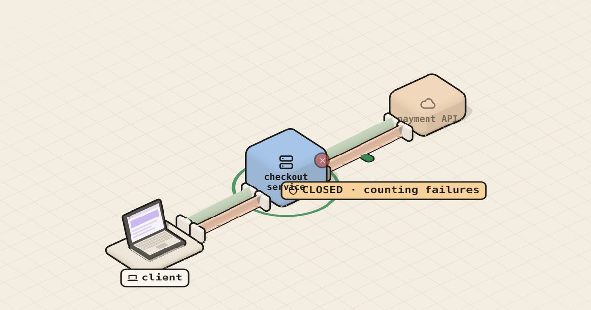

<div align="center">

# Backend Atlas

**3D animated backend interview prep, in the browser.**
System design, classic interview problems and senior Django, taught as step-by-step animated walkthroughs you can drag, replay and test yourself on.

[](https://github.com/0Mustafa37/learningdesgin/actions/workflows/checks.yml)


[**Live demo**](https://0mustafa37.github.io/learningdesgin/) · [Practice mode](https://0mustafa37.github.io/learningdesgin/#/practice) · [Django Q&A](https://0mustafa37.github.io/learningdesgin/#/django) · [Draw it yourself](https://0mustafa37.github.io/learningdesgin/#/draw)



</div>

## What it is

Backend Atlas is a revision site for backend interviews. Every topic is a step-by-step **3D animated walkthrough** (drag to rotate) with deep-dive notes, interview tips and sources, plus a timed practice mode and offline support. No frameworks, no build step: hand-written ES modules, a custom three.js scene engine, and a data-driven content format.

## What's inside

| Track | Contents |
| --- | --- |
| **System Design** | 45 lessons in 11 modules: foundations, scaling, data & storage, communication, reliability, architecture, security, shipping, whole-system designs, data-intensive patterns, designs from the field |
| **Interview Problems** | 27 problems across 5 levels. 14 classics (dual write, duplicate requests, lost update, exactly-once, distributed locks, stale reads, clocks, split brain, thundering herd, hot partitions, retry storms, poison messages, backpressure, pagination), plus senior (zero-downtime migrations, rollback safety, noisy neighbours, tail latency), team-lead (incidents, canaries and flags, error budgets, strangler migrations) and CTO problems (build vs buy, disaster recovery, cells, Conway's law, cloud costs) |
| **Senior Django** | 30 questions, each with a 3D walkthrough, model answer, code, follow-ups and links to the official docs, plus a filterable Q&A list and a mock-interview drill |

## Interactive features

- **Try it labs** on 10 lessons (Timeouts & Retries, Rate Limiting, Caching, Load Balancing, Sharding, Message Queues, Retry Storms, a PostgreSQL `EXPLAIN ANALYZE` indexes lab, Django N+1, connection pooling). Change the setup and a small simulation replays the scene with your settings. `data/labs.js`, `data/labs2.js`.
- **Draw it yourself** (`#/draw`): 9 design problems on a board, checked against a rubric of required parts, connections and red flags, with a model answer to compare. `draw.js`.
- **Today** (`#/today`): spaced-repetition review of finished lessons, weak practice answers and Django questions marked "review later" (Leitner boxes: 1, 2, 4, 8, 16, 32 days).
- **Voice answers** in Practice: answer out loud, see the transcript, and the checklist points you covered are ticked for you (Chrome, Edge, Safari).
- **Listen and Play as video**: every step can be read aloud, and "Play as video" runs the lesson by itself with captions. Audio comes from generated TTS (see below) or the browser's voice. `voice.js`.
- **Clips**: short captioned MP4s of selected lessons, rendered from the live scene by `tools/make_clips.py`.
- **Arabic key ideas** for every System Design step (toggle "عربي" on the key idea). `data/ar-keys.js`.
- **Progress sync** (optional): a Django + DRF service in `sync-api/`. Off until the `atlas-sync` meta tag in `index.html` points at a deployed copy.
- **Offline support** via a service worker, and instant search across lessons and questions (`Ctrl K`).

## Engineering highlights

- **Custom 3D engine** (`engine3d.js`, ~650 lines) on [three.js](https://threejs.org) (vendored in `vendor/`, MIT). Units are drawn from their `kind`, connections become pipes, and each step's flows play as packets in order, with a trace underneath. Steps can opt into richer scenes: custom event timelines (`ev`), live instruments through an `fx(t, S)` function (metrics, ground tags, a worker pool, countdown rings, a circuit-breaker gate), plus `setup`, `code` and `note` for the side panel. `data/dsl.js` documents the format; `timeouts-retries` in `data/sd-comm-reliability.js` uses all of it.
- **Data-driven content**: lessons, labs, draw rubrics and Django questions are plain JS data files, so new content needs no engine changes.
- **CI that actually opens the site**: `.github/workflows/checks.yml` runs on every push and pull request: syntax checks, `node tests/data.test.js` (every lab with every control combination, every draw model against its rubric), `python tests/sweep.py` (opens every lesson step in headless Chromium via Playwright and fails on any console error) and the sync-api Django test suite.
- **Generated narration pipeline**: a GitHub Actions workflow writes narration scripts, generates MP3s with TTS, commits them and re-voices edited steps automatically (details below).

## Getting started

No build step. The 3D engine is an ES module, so serve the folder rather than opening `index.html` from disk:

```bash
python3 -m http.server 8000
```

Then open http://localhost:8000.

## Project structure

```
index.html            app shell (routing, search, theme, meta)
app.js                UI, routing, practice, today, sync client
engine3d.js           custom three.js walkthrough engine
draw.js               draw-it-yourself board and rubric checker
voice.js              TTS playback and voice answers
sync.js               optional progress sync client
styles.css            hand-written design system (light/dark)
sw.js                 service worker for offline support
data/                 content: curriculum, lessons, labs, problems, Django, Arabic keys
sync-api/             optional Django 5 + DRF + PostgreSQL progress sync service
tools/                make_voices.py (TTS pipeline), make_clips.py (MP4 clips)
tests/                data.test.js (labs + rubrics), sweep.py (Playwright sweep)
.github/workflows/    checks.yml (CI), voices.yml (narration generation)
vendor/               three.js (MIT)
```

## Narration (generated voices)

Every step gets a narration script (45-75 s, English + Egyptian colloquial Arabic): what the diagram shows, why it happens, the real numbers, a common mistake or interview angle, and the key idea. Scripts are kept in `assets/voice/scripts.json` and shown under each step as "Full explanation". `tools/make_voices.py` reads the narration text from the site, calls the TTS engine, saves MP3s in `assets/voice/` with a hash of the text, and commits them. It resumes where it stopped, runs daily, and re-voices edited steps automatically.

Two engines:

- **edge** (default): Microsoft neural voices (Egyptian `ar-EG-ShakirNeural` / `ar-EG-SalmaNeural`, English `en-US-AndrewMultilingualNeural`). Free, no daily limit, whole course in one run.
- **gemini**: Gemini TTS. Create a key at [Google AI Studio](https://aistudio.google.com/apikey), add it as a repository secret named `GEMINI_API_KEY`, then run Actions → **voices**. The free tier allows about 10 voice files a day; enabling billing lifts that (the whole course is typically a dollar or two). Try one lesson first with `only` = `^timeouts-retries/` and `lang` = `ar`.

After voices exist, re-run `tools/make_clips.py` to put narration into the clips.

## Adding content

- `data/dsl.js` documents the compact lesson format. `data/labs.js` documents the lab format.
- System design lessons: `data/sd-*.js`. Interview problems: `data/interview-problems.js` and `data/ip-leadership.js`. Course order: `data/curriculum.js`.
- Django questions: `data/django.js`. Their 3D scenes and references: `data/django-scenes.js`.

## Built by

[Mustafa Mohamed](https://github.com/0Mustafa37), backend engineer (Python/Django). Built as a study tool for backend interviews, and as an exercise in how far vanilla JavaScript and a small custom engine can go without a framework.
